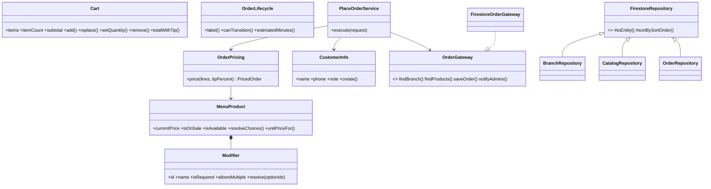

# Arquitectura orientada a objetos del menú

> Guía para entender (y explicar en clase) cómo está organizado el código. Rama: `refactor-poo`.

## Capas

```
src/
├── domain/            ← REGLAS DEL NEGOCIO. Clases puras de TypeScript, sin React ni Firebase.
│   ├── menu/          Modifier, MenuProduct
│   ├── cart/          Cart (inmutable)
│   ├── order/         OrderPricing, OrderLifecycle, CustomerInfo
│   ├── branch/        BranchContact
│   └── errors.ts      DomainError
├── infrastructure/    ← CÓMO se guardan/leen los datos (Firestore, API HTTP).
│   ├── firebase/      FirestoreRepository (base abstracta) → BranchRepository, CatalogRepository, OrderRepository
│   ├── api/           OrderApiClient
│   └── index.ts       instancias únicas: branchRepository, catalogRepository, orderRepository, orderApi
├── lib/server/        ← SOLO servidor: casos de uso (PlaceOrderService) y gateways con Firebase Admin.
├── features/          ← UI por funcionalidad (componentes pequeños + hooks que usan el dominio).
│   ├── customer/
│   └── admin/
└── app/               ← Rutas de Next.js (páginas y /api). Solo arman piezas, sin lógica.
```

**Regla de dependencia:** `app → features → infrastructure → domain`. El dominio no importa nada de las otras capas.

## Conceptos de POO aplicados

| Concepto | Dónde |
|---|---|
| **Encapsulamiento** | `MenuProduct` guarda los datos en privado y expone `currentPrice`, `isOnSale`, `unitPriceFor()`. Nadie calcula precios "a mano" fuera de la clase. |
| **Abstracción** | `OrderGateway` (interfaz): `PlaceOrderService` no sabe si los datos vienen de Firestore o de una prueba. |
| **Herencia** | `FirestoreRepository` (clase abstracta) → `BranchRepository`, `CatalogRepository`, `OrderRepository`. |
| **Polimorfismo** | Cualquier objeto que implemente `OrderGateway` sirve (Firestore real o uno falso en pruebas). |
| **Inmutabilidad / objetos de valor** | `Cart` devuelve un carrito nuevo en cada operación; `CustomerInfo` es un objeto de valor validado. |
| **Inyección de dependencias** | `new PlaceOrderService(gateway, legalVersion, now)`. |
| **Responsabilidad única** | Cada clase hace una cosa: `OrderPricing` calcula, `OrderApiClient` habla con la API, los componentes solo pintan. |

## Diagrama de clases



## Cliente (`src/features/customer/`)

`CustomerApp.tsx` es el contenedor: arma hooks y componentes, sin calcular nada.

| Hook | Responsabilidad | Usa |
|---|---|---|
| `useCart` | Carrito de la sucursal activa, guardado en el navegador | `Cart`, `LocalJsonStore` |
| `useProductEditor` | Opciones y cantidad del producto que se edita | `ProductSelection` → `MenuProduct` → `Modifier` |
| `useActiveOrder` | Seguimiento del pedido (API + Firestore en tiempo real) | `OrderLifecycle`, `orderApi`, `orderRepository` |
| `useCustomerDetails` | Nombre, teléfono, nota y aceptación legal (`LEGAL_VERSION`) | `LocalJsonStore` |
| `usePushNotifications` | Permiso y token push del pedido | `requestPushToken`, `orderApi` |
| `useOrderSubmission` | Validar y enviar el pedido | `Cart`, `BranchContact`, `orderApi` |
| `useMenuCatalog` | Menú en tiempo real con copia local | `MenuCatalog`, `catalogRepository` |
| `useBranchLinks` | WhatsApp, Instagram y tickets | `BranchContact` |

Clases nuevas del dominio: `ProductSelection` (selección inmutable del editor), `MenuCatalog` (búsqueda y secciones), `BranchDirectory` (orden de sucursales) y métodos de cliente en `OrderLifecycle` (`countdownLabel`, `hasReachedStep`, `blocksNewItems`, `suggestsWhatsappTicket`). En infraestructura, `LocalJsonStore<T>` (clase genérica) encapsula el `localStorage`.

## Reglas del proyecto
1. La lógica de negocio va en `domain/` con pruebas (`npm test`). Los componentes no calculan precios ni estados.
2. Los componentes no importan `firebase/*` directamente: usan `@/infrastructure`.
3. Componentes de máximo ~250 líneas; si crecen, se dividen. Un hook por responsabilidad (`useCart`, `useActiveOrder`…).
4. Nombres en inglés para código, textos de la UI en español.
5. `lib/services/menu.ts` es una fachada vieja: no usarla en código nuevo.
